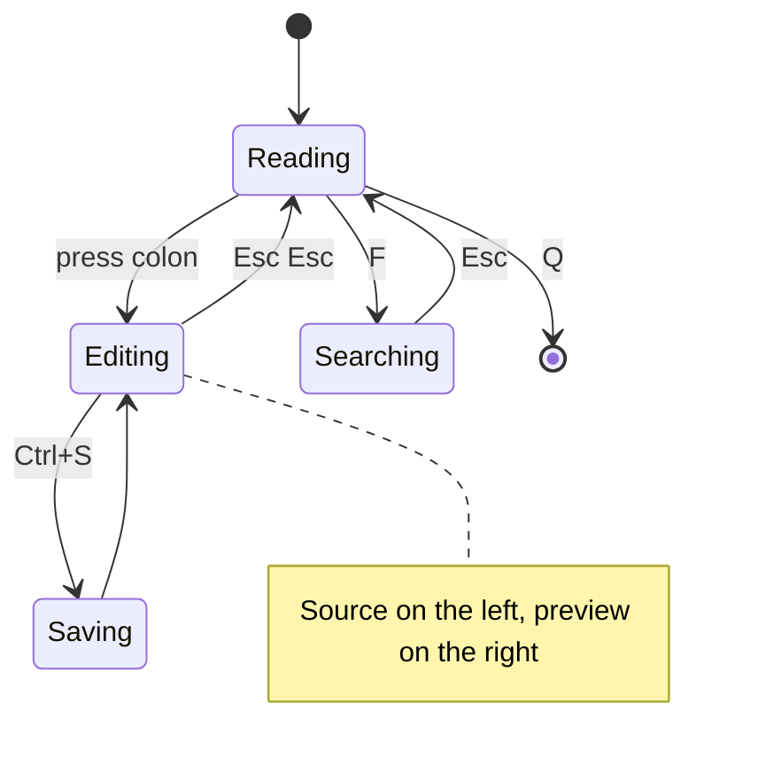
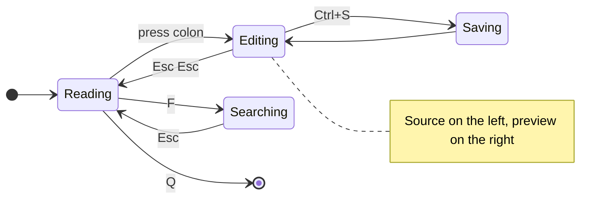
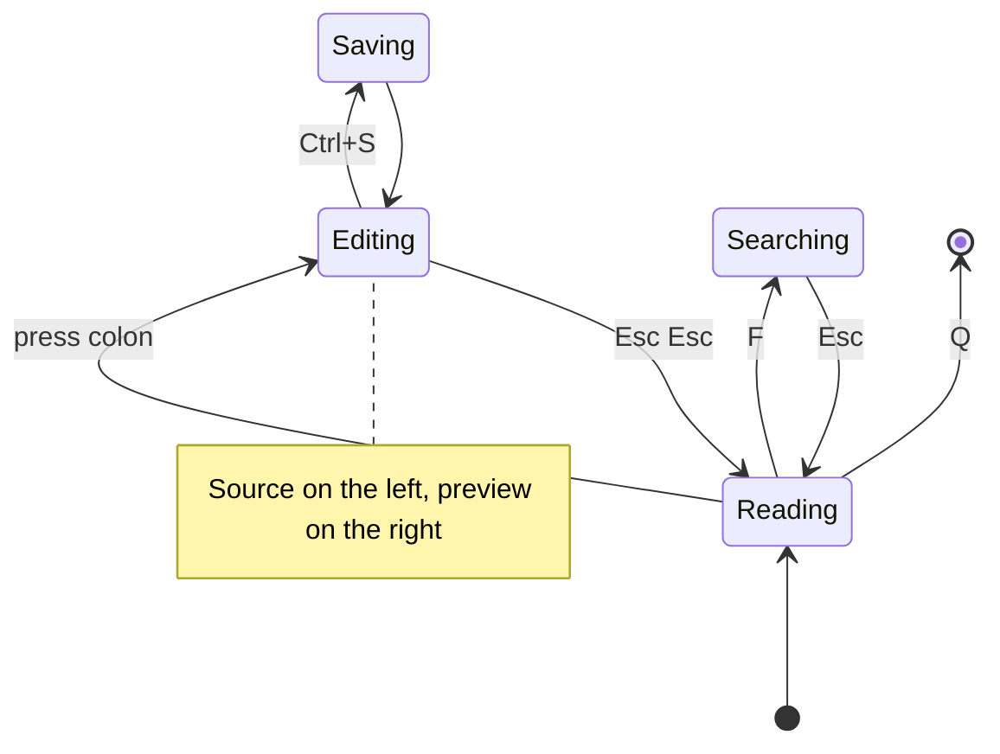
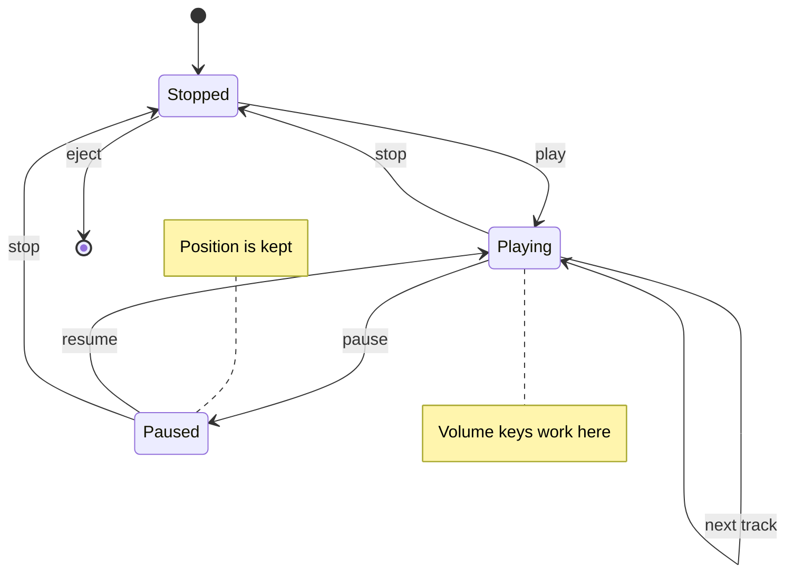
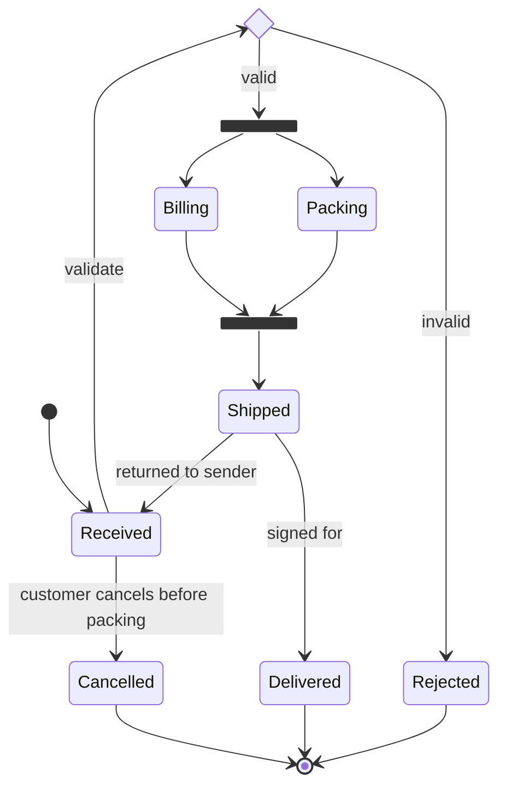
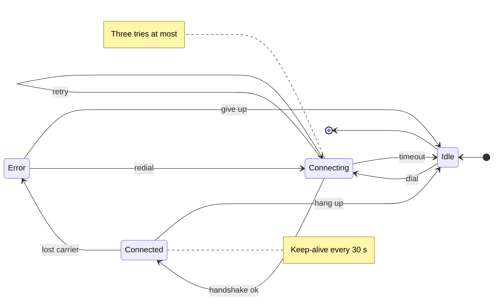
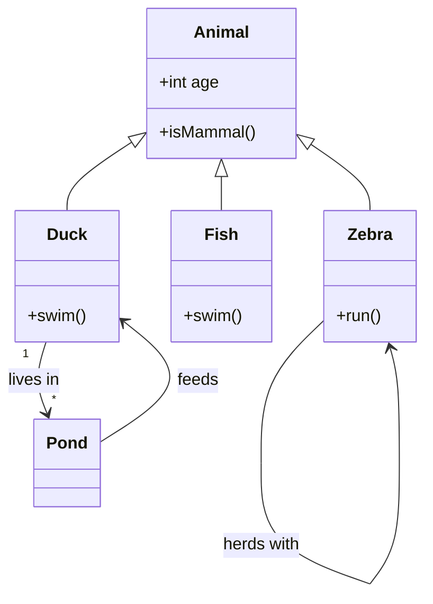
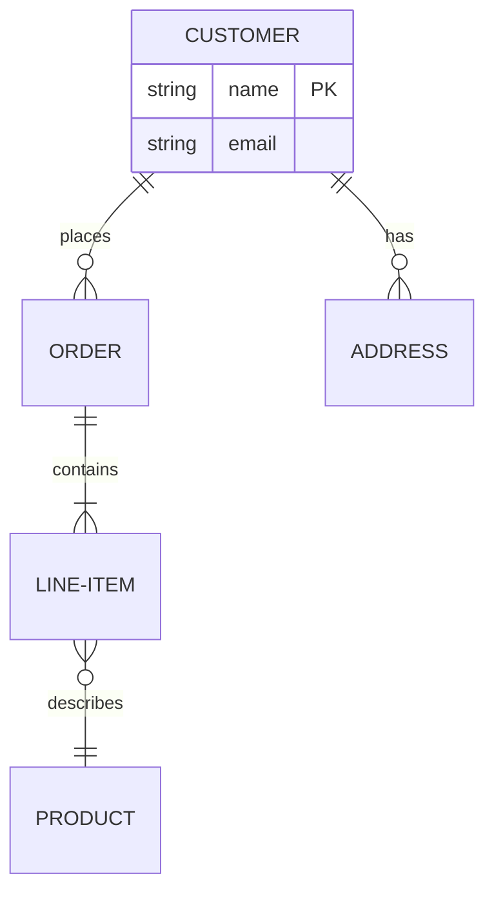

# Mermaid state diagrams

Tinta draws Mermaid **state diagrams** itself, without a browser. This page
mixes them with ordinary Markdown so the text around each diagram can be
checked too. The syntax is
[Mermaid's state diagram syntax](https://mermaid.js.org/syntax/stateDiagram.html).

## A viewer's keys

A back edge from a state with neighbours, and a note beside it. The label
*Esc Esc* and the note once landed on **Searching**.



| Key | From | To |
| --- | --- | --- |
| `:` | Reading | Editing |
| `Esc` `Esc` | Editing | Reading |
| `Ctrl+S` | Editing | Saving |
| `F` / `Esc` | Reading / Searching | Searching / Reading |

The same machine left to right. A note *right of* a state sits below it in
horizontal diagrams, where Mermaid puts it:



And bottom to top, with the note on the left:



## A player

> A transition to the same state loops beside it, and its label sits
> beyond the loop. Notes on either side keep their room.



1. Edges to the next state down leave and enter their states at their own
   points, so each label has a line of its own.
2. Edges back up, and edges that skip states, run in a lane beside every
   state they pass.
3. A label goes where it covers no state, note or other label.

## An order

Choices, forks and joins, a long label, and a return over five states:



A connection, right to left, with a retry loop and notes on both sides:



## Class and ER diagrams

Class and entity-relationship diagrams share the edge routing:





The source of the first diagram, as a plain code block:

```text
stateDiagram-v2
    Editing --> Reading : Esc Esc
    note right of Editing : Source on the left, preview on the right
```

- Text after the diagrams still lays out below them.
- ~~Overlapping labels~~ are gone.
